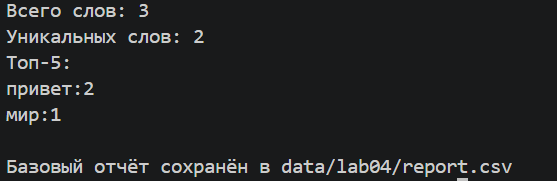
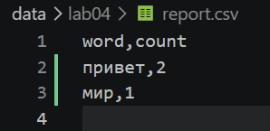
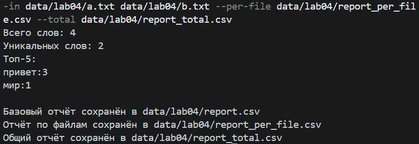

# Лабораторная работа №4 (Файлы: TXT/CSV)

## Описание
Скрипт `text_report.py` читает текстовый файл, считает частоты слов (используя модуль `lib.text` из ЛР3) и сохраняет результат в формате CSV.

## Команды запуска (Базовая версия)

Запуск с настройками по умолчанию (читает `data/lab04/input.txt`, пишет `data/lab04/report.csv`):

`python src/lab04/text_report.py`

Запуск с указанием своих путей:

`python src/lab04/text_report.py --in data/lab04/input.txt --out data/lab04/my_report.csv`

## Работа с кодировками
По умолчанию файлы читаются в кодировке `UTF-8`. Если ваш файл сохранен в другой кодировке (например, `cp1251`), укажите её явно при запуске:

`python src/lab04/text_report.py --encoding cp1251`

## Политика для пустого входа
Если входной файл пуст (или в нём нет слов), скрипт не завершается с ошибкой. Он выводит нулевую статистику в консоль, а в итоговый `report.csv` записывает **только заголовок**.

---

## Дополнительное задание (★)

Скрипт поддерживает обработку нескольких файлов одновременно и генерацию двух отчётов (сводного и по каждому файлу).

Запуск:

`python src/lab04/text_report.py --in data/lab04/a.txt data/lab04/b.txt --per-file data/lab04/report_per_file.csv --total data/lab04/report_total.csv`

- `--in` — список путей к файлам (через пробел).
- `--per-file` — путь для сохранения отчёта с колонками `file, word, count` (сортировка: файл ↑, частота ↓, слово ↑).
- `--total` — путь для сохранения сводного отчёта по всем файлам с колонками `word, count`.

---

## Скриншоты работы программы

### Базовый запуск

### Пример сгенерированного report.csv

### Запуск со списком файлов (★)

