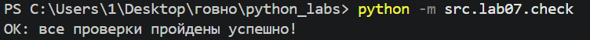

# Лабораторная работа №7 (Поиск, сортировка и измерение времени)

## Реализованные алгоритмы
- `search.py`: линейный и бинарный поиск, Two Sum (перебор и через словарь).
- `sorting.py`: пузырёк, вставки, выбор. Возвращают новый список.
- `check.py`: проверка алгоритмов на случайных данных против встроенных `sorted` и `list.index`.

## Таблица бенчмарка
| Task | N | Impl | Seconds |
|---|---|---|---|
| sort | 1000 | sorted | 0.0001 |
| sort | 1000 | bubble | 0.0263 |
| sort | 1000 | insertion | 0.0118 |
| sort | 1000 | selection | 0.0119 |
| sort | 10000 | sorted | 0.0009 |
| sort | 10000 | bubble | 2.919 |
| sort | 10000 | insertion | 1.2371 |
| sort | 10000 | selection | 1.0945 |
| sort | 100000 | sorted | 0.0113 |
| sort | 100000 | bubble | > 60 |
| sort | 100000 | insertion | > 60 |
| sort | 100000 | selection | > 60 |
| search | 100000 | linear | 1.0267 |
| search | 100000 | binary | 0.0116 |
| two_sum | 1000 | brute | 0.0 |
| two_sum | 1000 | fast | 0.0 |
| two_sum | 10000 | brute | 0.0 |
| two_sum | 10000 | fast | 0.0 |

## Выводы по бенчмарку

**Сортировки.** Из таблицы видно, что при увеличении объема данных в 10 раз (с 1000 до 10000) время пузырька выросло примерно в 100 раз (с 0.026 до 2.919 секунд). Это наглядно подтверждает квадратичную сложность \(O(N^2)\). Встроенная функция `sorted` (использующая Timsort) замедлилась лишь в 9 раз, так как её сложность \(O(N \log N)\). При \(N = 100 000\) квадратичные сортировки работают дольше 60 секунд, что доказывает их непригодность для больших данных.

**Поиск и Two Sum.** Линейный поиск 10 000 элементов в массиве на 100 000 занял ~1 секунду (\(O(N)\)), тогда как бинарный поиск справился за 0.01 секунды благодаря сложности \(O(\log N)\). Однако бинарный поиск требует предварительной сортировки массива, которая сама по себе стоит \(O(N \log N)\). Поэтому бинарный поиск окупается только при многократных запросах к одним и тем же данным. В задаче Two Sum алгоритм через словарь работает за \(O(N)\), но на малых объемах разница незаметна. Значения `0.0` в таблице означают, что алгоритм выполнился быстрее, чем за 0.0001 секунды (погрешность округления).

## Проверка (check.py)
Запуск `python -m src.lab07.check` прогоняет 100 случайных тестов для каждой функции. Были найдены и исправлены неточности в проверке бинарного поиска (из-за дубликатов). Итоговый результат: `OK: все проверки пройдены успешно!`.

